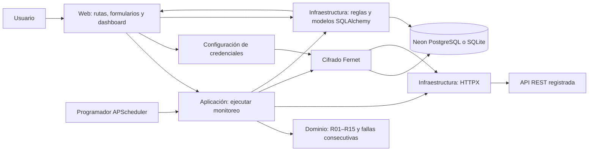

# Arquitectura del sistema experto

La implementación usa una **arquitectura por capas ligera**. Para este sistema experto, el núcleo de reglas y la política de fallas consecutivas deben poder probarse sin FastAPI, HTTPX ni PostgreSQL. Un conjunto completo de interfaces y repositorios de Clean Architecture agregaría más código que valor a este proyecto; el caso de uso de monitoreo usa SQLAlchemy de forma explícita y concentra esa integración en un solo módulo. Se conservan los cuatro componentes de la fase 1: ingreso, base de conocimiento, motor de inferencia y resultados explicables.

## Responsabilidades

| Capa o archivo | Responsabilidad |
|---|---|
| `app/domain/rules.py` | Base declarativa R01–R15 y motor de encadenamiento hacia adelante; no importa librerías web ni de base de datos. |
| `app/domain/monitoring.py` | Determina fallas consecutivas de la misma URL a partir de observaciones. |
| `app/application/authentication.py` | Valida el tipo de autenticación, el header y las condiciones para conservar o reemplazar un secreto. |
| `app/application/monitoring.py` | Coordina GET, historial, inferencia y guardado del diagnóstico explicable. |
| `app/infrastructure/http_monitor.py` | Valida destinos y realiza la solicitud GET con timeout y medición de latencia. |
| `app/infrastructure/credentials.py` | Cifra y descifra secretos con una clave que vive fuera de la base de datos. |
| `app/infrastructure/knowledge.py` | Inicializa y lee las reglas persistidas, conservando cambios posteriores. |
| `app/infrastructure/models.py`, `database.py`, `schema.py` | Entidades SQLAlchemy, sesiones, conexión y compatibilidad de tablas existentes. |
| `app/infrastructure/scheduler.py` | Ejecuta el caso de uso cuando vence el intervalo de una API activa. |
| `app/web/routes.py`, `security.py` | Rutas, dashboard, formularios, respuestas JSON y protección CSRF. |
| `app/web/templates/`, `static/` | HTML, CSS y JavaScript de la interfaz. |
| `app/main.py` | Compone FastAPI, rutas, archivos estáticos, base de datos y programador. |

## Datos y razonamiento

1. `apis` conserva servicio, URL, código esperado, estado activo e intervalo de monitoreo.
2. `credenciales_api` guarda el tipo de autenticación, metadatos y el secreto cifrado; nunca el secreto legible. La clave de cifrado está en `.env` y el secreto se descifra solo para construir el GET saliente.
3. `monitoreos` guarda cada solicitud con la URL y el código esperado vigentes en ese momento. Esto evita reinterpretar el historial después de editar un servicio.
4. `reglas` conserva prioridad, estado activo y definición de cada regla. El motor carga solo reglas activas y con condiciones conocidas.
5. `diagnosticos` guarda hechos, gravedad y resumen. `diagnostico_reglas` indica qué reglas justifican el resultado. `recomendaciones` guarda las acciones propuestas.
6. El motor inicia con hechos observados y repite la evaluación hasta que ninguna regla agregue conclusiones. Ejemplo: HTTP 500 → R02; tres fallas consecutivas → R12; ambas conclusiones → R13; prioridad alta → R15.

## Límites operativos actuales

- El proceso local consulta APIs mediante GET y ejecuta los intervalos de 1, 5 o 10 minutos mientras está abierto. Se inicia con un solo proceso de Uvicorn para evitar programadores duplicados.
- Los destinos deben estar en `ALLOWED_TARGET_HOSTS`; los destinos privados requieren además `ALLOWED_PRIVATE_HOSTS`. Los redireccionamientos HTTP no se siguen.
- Las credenciales admiten Bearer, API key en header y Basic. Se exige HTTPS, excepto en localhost; los secretos no se incluyen en resultados JSON, HTML ni mensajes de error de conexión.
- El dashboard acepta solo los hosts de `ALLOWED_APP_HOSTS`, exige token CSRF en formularios POST y escucha en `127.0.0.1`. Una publicación pública requiere autenticación y controles adicionales de salida.
- PostgreSQL exige conexión cifrada mediante `sslmode=require`, `verify-ca` o `verify-full`.
- SQLite sirve para la demostración local. Neon PostgreSQL se verificó el 20/11/2026: conexión cifrada, siete tablas, 15 reglas y casos HTTP integrales C01–C08 aprobados.
- El sistema plantea causas probables a partir de respuestas externas; las recomendaciones no modifican las APIs monitoreadas.

## Verificación

`python -m pytest -q` cubre reglas, persistencia, monitoreo periódico, autenticación, reactivación y controles de seguridad. Con el servidor activo, `python -m scripts.validate_live --cleanup` recorre C01–C08 mediante HTTP contra los endpoints locales de demostración y elimina los servicios de prueba al terminar. La [matriz de validación](FASE2_VALIDACION.md) documenta la evidencia y el guion para la presentación.
