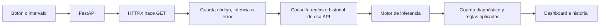

# Guía de la interfaz de usuario

Esta guía explica la pantalla web **Sentinel**, qué puede hacer el usuario y qué sucede detrás de cada acción. La interfaz está hecha con HTML, CSS y un poco de JavaScript; FastAPI genera la página con Jinja2 y procesa los formularios. Se abre en `http://127.0.0.1:8000` después de ejecutar `python -m app`.

## Qué se ve al abrirla

La pantalla principal (`GET /`) está dividida en cuatro zonas:

| Zona | Qué muestra | Para qué sirve |
|---|---|---|
| Barra lateral | Enlaces a Resumen, Servicios y Actividad; número de reglas activas | Moverse entre las secciones de la misma pantalla |
| Indicadores superiores | Disponibilidad reciente, verificaciones totales y de hoy, APIs activas, incidentes críticos recientes | Ver rápidamente cómo han respondido los servicios |
| Servicios monitoreados | Nombre, URL, último estado, latencia, código HTTP, intervalo y controles | Monitorear, editar o desactivar cada API |
| Actividad reciente | Últimos diez monitoreos con resultado, gravedad, hora y botón «Explicar» | Revisar diagnósticos y recomendaciones |

La página se adapta a pantallas pequeñas. Cuando todavía no hay APIs o mediciones, muestra estados vacíos con instrucciones para comenzar.

### Cómo se calculan los indicadores

- **Disponibilidad reciente:** porcentaje de respuestas cuyo código coincidió con el configurado como esperado, calculado sobre los últimos **25 monitoreos**. Si no hay mediciones, muestra `—`. La pequeña gráfica usa hasta doce resultados reales; cada punto representa una respuesta esperada o inesperada.
- **Verificaciones:** total histórico de monitoreos y cuántos se ejecutaron desde el inicio del día en UTC.
- **Servicios activos:** número de APIs que pueden monitorearse. Las desactivadas se conservan aparte.
- **Incidentes críticos:** cantidad de diagnósticos de gravedad `alta` entre los últimos 25 registros. Es un conteo de eventos recientes, no una lista de incidentes abiertos.

## Registrar una API

En **Conecta un servicio**, el usuario llena:

1. **Nombre:** etiqueta que aparecerá en el dashboard.
2. **URL del endpoint:** dirección HTTP o HTTPS que el sistema consultará.
3. **HTTP esperado:** código que se considera respuesta correcta; por defecto es `200`.
4. **Verificar cada:** intervalo de 1, 5 o 10 minutos.

Al pulsar **Agregar a monitoreo**, el navegador envía un formulario interno a `POST /apis`. FastAPI valida los datos y el destino, guarda el servicio en la tabla `apis` y vuelve al dashboard. Un error de validación se muestra en una franja sobre la pantalla. Registrar una API **no** hace todavía una solicitud al servicio externo; la primera puede ejecutarse manualmente con `↻` o cuando llegue su turno automático.

La lista `ALLOWED_TARGET_HOSTS` de `.env` define qué nombres de host se pueden registrar. Los destinos privados requieren además `ALLOWED_PRIVATE_HOSTS`. Por defecto se permite localhost para las pruebas de clase.

## Administrar y monitorear servicios

Cada servicio activo tiene dos controles:

- **`↻` Monitorear ahora:** envía `POST /apis/{id}/monitor` al propio backend. FastAPI solicita al servicio registrado mediante **HTTP GET** con HTTPX. La interfaz usa POST solo para comunicar la pulsación del botón; el monitoreo hacia la API sigue siendo GET.
- **`···` Editar:** permite cambiar nombre, URL, código esperado e intervalo. También muestra **Desactivar servicio**. La desactivación detiene verificaciones futuras y oculta la API del listado activo, pero conserva el historial.

Debajo del listado aparece **Servicios desactivados** cuando hay alguno. Desde ahí se puede **Reactivar** y volver a monitorear esa API. Si se cambia la URL, las fallas de la dirección anterior no cuentan para una nueva secuencia de tres fallas consecutivas.

### Monitoreo automático

Mientras la aplicación esté abierta, APScheduler revisa cada minuto qué APIs activas tienen su intervalo vencido. Para cada una ejecuta el mismo flujo que el botón manual. El sistema usa un solo proceso local de Uvicorn, por lo que no se duplican programadores. Al cerrar la aplicación se detienen las verificaciones periódicas.

## Qué ocurre después de una medición

El motor trabaja con hechos, como `status_code=500`, `latency_ms=2800` o `consecutive_failures=3`. Lee las reglas activas de la base de conocimiento y aplica **encadenamiento hacia adelante**: una conclusión puede habilitar otra regla. El resultado se guarda en `monitoreos`, `diagnosticos`, `diagnostico_reglas` y `recomendaciones`.

Dos ejemplos:

- **HTTP 200 en 300 ms:** se activa R01. El servicio aparece como **Operativo** y el diagnóstico tiene gravedad `normal`.
- **Tercera respuesta HTTP 500 consecutiva de la misma API:** R02 detecta error interno; R12 agrega `falla_persistente`; R13 clasifica prioridad alta; R15 recomienda revisión inmediata. En la UI aparece **Crítico**.

Los diagnósticos son **causas probables** basadas en respuestas observables. El sistema no repara ni modifica el servicio monitoreado.

## Leer el resultado y la explicación

La tarjeta de cada API muestra el **último** monitoreo de ese servicio, aunque haya quedado fuera de los 25 eventos recientes. La tabla **Actividad reciente** muestra los últimos diez eventos de todas las APIs:

- **Resultado:** código HTTP recibido o tipo de error, por ejemplo `timeout`.
- **Latencia:** duración de la solicitud en milisegundos.
- **Diagnóstico:** gravedad `normal`, `baja`, `media`, `alta` o `informativa`.
- **Explicar:** abre el resumen, recomendaciones y las reglas que se activaron, con su identificador R01–R15.

**Ver más (JSON)** abre `GET /api/history` en una pestaña nueva. Actualmente presenta los últimos 50 registros en JSON para consulta técnica; el parámetro `limit` permite pedir hasta 200. El dashboard muestra el resumen visual. Las horas se almacenan en UTC y la tabla las presenta con ese mismo horario.

## Protección de las acciones de la UI

Los formularios que registran, editan, monitorean, desactivan o reactivan una API llevan un token CSRF. FastAPI compara ese valor con una cookie antes de aceptar el cambio. El dashboard solo escucha en `127.0.0.1` y acepta los hosts indicados en `ALLOWED_APP_HOSTS`. Estas medidas corresponden al uso local del proyecto; no equivalen a un sistema de cuentas de usuario para publicar la aplicación.

## Prueba rápida en clase

El bloque **Prueba local lista para usar** muestra rutas simuladas. Para registrarlas hay que anteponer `http://127.0.0.1:8000`:

| URL | Resultado que permite demostrar |
|---|---|
| `/demo/status/200` | Servicio normal, R01 |
| `/demo/status/500` | Error interno R02; al repetir tres veces, R12, R13 y R15 |
| `/demo/status/503` | Servicio no disponible R04; al repetir tres veces, R12, R14 y R15 |
| `/demo/delay/2200` | Rendimiento degradado, R10 |
| `/demo/delay/9000` | Timeout y regla R11 con el límite predeterminado de 8 segundos |

El [guion y la matriz de validación](FASE2_VALIDACION.md) contienen los casos C01–C07. La implementación de la interfaz está en `app/web/templates/index.html`, `app/web/static/app.css` y `app/web/static/app.js`. La [arquitectura](ARQUITECTURA.md) explica cómo se comunican esos archivos con los demás módulos.

La interfaz y los casos C01–C07 se verificaron con Neon PostgreSQL el 19/11/2026. La conexión se toma de `.env`; las credenciales no aparecen en la interfaz ni en la salida de validación.
