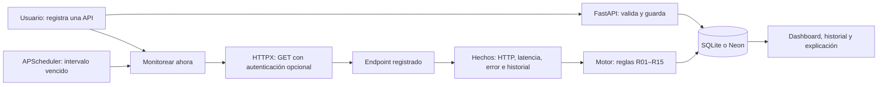

# Guía para ejecutar y probar Sentinel en local

Esta guía cubre la instalación, el flujo del sistema experto, las pruebas manuales C01–C08 y las pruebas automatizadas. La ruta recomendada para la demostración en clase es **Python en Windows PowerShell**. Docker Compose queda como alternativa reproducible para otro equipo.

## 1. Requisitos y elección de base de datos

| Ruta | Necesitas | Base de datos |
|---|---|---|
| Python | Python 3.11 o superior y acceso a instalar `requirements.txt` | SQLite por defecto; Neon si configuras `DATABASE_URL` |
| Docker | Docker Desktop con el motor iniciado y Docker Compose | SQLite en un volumen persistente por defecto; Neon si está en `.env` |

En ambos casos, el servidor se abre en <http://127.0.0.1:8000>. Usa **una ruta a la vez**, porque ambas ocupan el puerto 8000. No hace falta instalar PostgreSQL para usar SQLite ni para conectarse a Neon.

`.env.example` contiene valores de ejemplo y se puede compartir. `.env` contiene la conexión real, la clave de cifrado y los hosts autorizados; está excluido de Git. Si usas la **misma base Neon en dos equipos** y ya guardaste credenciales de APIs, ambos deben tener la **misma** `CREDENTIALS_ENCRYPTION_KEY`. Generar otra clave impide descifrar esas credenciales.

## 2. Arranque con Python en PowerShell

Desde una carpeta donde quieras guardar el proyecto:

```powershell
git clone https://github.com/SebastianGalindo2o26/SE.git
Set-Location SE
python --version
python -m venv .venv
& .\.venv\Scripts\python.exe -m pip install -r requirements.txt
if (-not (Test-Path .env)) { Copy-Item .env.example .env }
& .\.venv\Scripts\python.exe -m scripts.setup_credentials
& .\.venv\Scripts\python.exe -m app
```

Comprueba que `python --version` indique 3.11 o superior. Si ya clonaste el proyecto, entra en su carpeta y usa `git pull` antes de instalar dependencias. Si ya existe `.env`, consérvalo: el comando anterior no lo reemplaza. `scripts.setup_credentials` no cambia una clave que ya existe.

Al ver `Uvicorn running on http://127.0.0.1:8000`, abre esa dirección en el navegador. Deja la terminal abierta mientras pruebas. Para detener el servidor, pulsa `Ctrl+C`.

Para usar Neon, edita `DATABASE_URL` en `.env` con la URL PostgreSQL que incluye `sslmode=require` antes de iniciar. Para una demo sin cuenta Neon, conserva `DATABASE_URL=sqlite:///./api_expert.db`; el archivo SQLite se crea al primer arranque. En ambos casos se crean las siete tablas y se cargan las 15 reglas iniciales.

## 3. Arranque alternativo con Docker Compose

Docker es útil si quieres repetir la demo sin instalar Python en el otro equipo. El contenedor usa un solo proceso de Uvicorn para que el programador de monitoreo no se duplique. El puerto se publica solo en `127.0.0.1` del equipo; SQLite se guarda en el volumen `sentinel_data` y sobrevive a `docker compose down`.

El puerto local sigue la [configuración de publicación de Docker](https://docs.docker.com/get-started/docker-concepts/running-containers/publishing-ports/) y el almacenamiento usa un [volumen de Compose](https://docs.docker.com/reference/compose-file/volumes/).

Primero inicia Docker Desktop. Luego, en PowerShell dentro del proyecto:

```powershell
if (-not (Test-Path .env)) { Copy-Item .env.example .env }
docker compose build
docker compose run --rm sentinel python -m scripts.setup_credentials
docker compose up -d
docker compose ps
```

Abre <http://127.0.0.1:8000>. Para ver la actividad o detenerlo:

```powershell
docker compose logs -f sentinel
docker compose down
```

El comando de preparación monta el `.env` local y crea allí la clave sin mostrarla. Si `.env` ya apunta a Neon, Docker usará esa misma conexión. Si apunta a SQLite, el archivo de la base queda dentro del volumen persistente. `docker compose down` conserva ese volumen; no uses `down -v` si quieres mantener los datos. Si cambia `requirements.txt` o el código, vuelve a ejecutar `docker compose build` y `docker compose up -d`.

## 4. Qué hace cada componente



| Parte | Archivo principal | Función |
|---|---|---|
| Interfaz de ingreso y resultados | `app/web/templates/`, `app/web/static/`, `app/web/routes.py` | Recibe el formulario, presenta estado, historial y reglas activadas. |
| Protección de formularios | `app/web/security.py` | Exige token CSRF en acciones que modifican datos. |
| Monitoreo y diagnóstico | `app/application/monitoring.py` | Coordina GET, mediciones anteriores, inferencia y guardado. |
| Base de conocimiento | `app/infrastructure/knowledge.py`, tabla `reglas` | Carga R01–R15 y lee las reglas activas. |
| Motor de inferencia | `app/domain/rules.py`, `app/domain/monitoring.py` | Aplica encadenamiento hacia adelante y detecta tres fallas seguidas de la misma API. |
| HTTP y credenciales | `app/infrastructure/http_monitor.py`, `credentials.py` | Valida destino, envía GET, mide latencia y descifra la credencial solo para la solicitud. |
| Persistencia | `app/infrastructure/models.py`, `database.py`, `schema.py` | Mantiene siete tablas en SQLite o Neon. |
| Monitoreo periódico | `app/infrastructure/scheduler.py` | Revisa cada minuto qué API activa tiene su intervalo vencido. |

**Flujo en la interfaz:** la navegación lateral cambia entre Resumen, Servicios y Actividad sin desplazar la página; ☰ oculta o muestra la barra. En Servicios escribe nombre, URL, respuesta HTTP esperada (elige código y descripción, por ejemplo `200 · OK`), intervalo y autenticación si hace falta. **Agregar a monitoreo** guarda el endpoint, pero aún no lo consulta. Pulsa **Monitorear ahora** para ejecutar el GET. Los resultados y sus explicaciones aparecen en Actividad. El proceso también monitorea automáticamente cada 1, 5 o 10 minutos mientras permanezca abierto.

## 5. Casos manuales C01–C08

En todos los casos indica **HTTP esperado = 200**. Para las rutas de la tabla, antepón `http://127.0.0.1:8000`. Registra cada caso como servicio separado salvo que la tabla indique repetir el mismo servicio. Después pulsa **Monitorear ahora** el número de veces indicado y revisa **Actividad reciente → Explicar**.

| Caso | Ruta y acciones | Resultado y reglas esperadas |
|---|---|---|
| C01 | `/demo/status/200`, una medición | HTTP 200, gravedad `normal`, R01. |
| C02 | `/demo/status/500`, primera medición | HTTP 500, gravedad `media`, R02. |
| C03 | `/demo/status/401`, una medición, sin autenticación | HTTP 401, gravedad `baja`, R06; recomienda revisar autenticación. |
| C04 | `/demo/delay/2200`, una medición | HTTP 200 con latencia superior a 1500 ms, gravedad `baja`, R10. |
| C05 | `/demo/delay/9000`, una medición | Timeout con `REQUEST_TIMEOUT_SECONDS=8`, gravedad `media`, R11. Espera unos ocho segundos. |
| C06 | `/demo/status/503`, tres mediciones del **mismo** servicio | Tercera medición: gravedad `alta`, R04, R12, R14 y R15. |
| C07 | `/demo/status/500`, tres mediciones del **mismo** servicio | Tercera medición: gravedad `alta`, R02, R12, R13 y R15. La primera equivale a C02. |
| C08 | `/demo/auth`, una medición; selecciona **API key en header**, nombre `X-Demo-Key`, clave de demo `sentinel-demo` | HTTP 200, gravedad `normal`, R01. El secreto no aparece en el dashboard ni en el historial JSON. |

La clave de C08 es pública y sirve solo para la simulación local. Si pruebas `/demo/auth` sin esa clave o con otra, recibirás HTTP 401 y la regla R06. Para C06 y C07, la persistencia se calcula por **servicio y URL**; si cambias la URL, la secuencia de fallas comienza de nuevo.

## 6. Pruebas automatizadas y verificación de base

Con el servidor abierto en una terminal, ejecuta en **otra** terminal dentro del proyecto:

```powershell
& .\.venv\Scripts\python.exe -m pytest -q
& .\.venv\Scripts\python.exe -m scripts.validate_live --cleanup
& .\.venv\Scripts\python.exe -m scripts.check_database
```

En Docker, ejecuta las pruebas HTTP y la comprobación de base dentro del contenedor:

```powershell
docker compose exec sentinel python -m scripts.validate_live --cleanup
docker compose exec sentinel python -m scripts.check_database
```

`pytest` verifica reglas, persistencia, autenticación Bearer/API key/Basic, cifrado, formularios, monitoreo automático y arranque con SQLite temporal. Se esperan **25 pruebas aprobadas**. `validate_live` reproduce C01–C08 por HTTP en la base configurada y `--cleanup` elimina los siete servicios que creó. `check_database` debe mostrar siete tablas y 15 reglas; si la base no tenía datos previos, al terminar verá `apis=0`, `monitoreos=0` y `credenciales_api=0`. Las pruebas automatizadas usan bases temporales y no insertan datos en Neon; la validación HTTP sí usa la base configurada y luego limpia sus registros.

**Verificación realizada el 20/11/2026:** `docker compose config --quiet` y `docker compose build` terminaron correctamente; el contenedor respondió `200` en `/health`, aprobó C01–C08 con Neon y dejó `apis=0`, `monitoreos=0`, `credenciales_api=0`. Un segundo contenedor encontró el archivo SQLite y sus siete tablas en el mismo volumen, confirmando que persistió entre ejecuciones. El contenedor de la prueba se detuvo con `docker compose down`.

## 7. Probar una API real

1. Confirma que tienes permiso para consultar ese endpoint y que admite GET.
2. Registra la URL pública completa, el código esperado y el intervalo; no necesitas cambiar `.env` por cada API. Si el destino es privado, añade su hostname exacto a `ALLOWED_PRIVATE_HOSTS` en `.env` y reinicia la aplicación. No pongas tokens en la URL.
3. Si la API usa una ruta específica para comprobar salud, escribe esa ruta en la URL; el sistema consulta exactamente esa dirección con GET.
4. Si requiere autenticación, elige Bearer, API key en header o Basic. Para API key escribe el nombre exacto del header. Las credenciales requieren HTTPS, salvo localhost para la demo.
5. Pulsa **Monitorear ahora**, revisa el código recibido y abre **Explicar**. Un 401 suele indicar token ausente, incorrecto o vencido; un 403 indica falta de permiso. El motor propone causas probables a partir de la respuesta observada.

Al editar una API protegida, dejar el secreto vacío conserva el anterior; escribir uno nuevo lo reemplaza; elegir **Sin autenticación** lo elimina. OAuth2 con renovación, firmas por solicitud, certificados de cliente y métodos distintos de GET requieren una integración específica.

## 8. Problemas frecuentes

| Síntoma | Qué revisar |
|---|---|
| No abre `127.0.0.1:8000` | Confirma que el proceso sigue abierto; si el puerto está ocupado, detén la otra instancia de Python o Docker. |
| `ModuleNotFoundError` | Activa el entorno virtual indicado e instala `requirements.txt`. |
| «El destino resuelve a una dirección privada» | Si es una API privada autorizada, agrega su hostname exacto a `ALLOWED_PRIVATE_HOSTS` y reinicia. |
| «Configura CREDENTIALS_ENCRYPTION_KEY» | Ejecuta `python -m scripts.setup_credentials` o el equivalente de Docker. |
| «No se pudo descifrar la credencial» | Restaurar la misma clave de cifrado usada al guardar el secreto; una clave nueva no sirve para datos existentes. |
| HTTP 401/403 en una API real | Revisa token, header, usuario, permisos y código esperado. |
| Timeout | Revisa disponibilidad y `REQUEST_TIMEOUT_SECONDS` en `.env`; C05 lo provoca deliberadamente. |
| Neon no conecta | Revisa `DATABASE_URL`, acceso a internet y `sslmode=require`; no pegues la URL completa en capturas o reportes. |
| Docker no inicia | Abre Docker Desktop y comprueba `docker info`; `docker compose config --quiet` solo valida la configuración y no requiere el motor. |

La [guía de interfaz](GUIA_INTERFAZ.md) explica cada control visual, la [arquitectura](ARQUITECTURA.md) detalla las capas y la [matriz de fase 2](FASE2_VALIDACION.md) relaciona los casos con los entregables.
